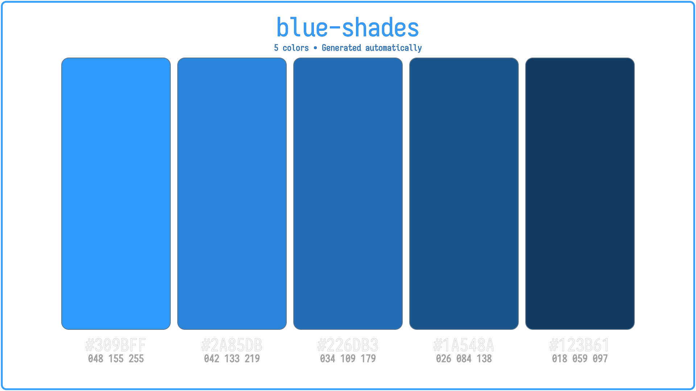

<div id="main-title" align="center"> 
	<picture>
		
	</picture>

# Palette Generator CLI
**Generate color palettes and export them as SVG and PNG**

#### 🏷 Latest Release: [Palette Generator CLI v1.0](https://github.com/AbibPerez/palette-generator_CLI/releases/tag/v1.0.0)

</div>

<div id="before-clone" align="left">

## ✨ Features
- HEX validation
- RGB conversion
- SVG export
- PNG export
- ANSI terminal preview

## 🖼️ Example 

<div id="example-image" align="center">
	<picture>
		
	</picture>
</div>

## 📦 Installation

```Shell
# Clone repository
git clone https://github.com/AbibPerez/palette-generator_CLI.git

# Open cloned repository
cd palette-generator_CLI

# Install dependencies
npm install
```

### 🤖 Requirements for Android (Termux)
PNG export on Android (Termux) requires Inkscape.

Install Inkscape:
```bash
pkg install -y inkscape
```

## 🚀 Usage
```Shell
# Run application
npm start
```


## 🗄️ Palette Schema
Each palette is stored as an array of color objects containing HEX and RGB values.

```JSON
{
  "blue-shades": [
    {
      "hex": "#309BFF",
      "rgb": {
          "r": 48,
          "g": 155,
          "b": 255
      }
    }
  ]
}
```

## 📁 Output
After generation, the following files are created:

```Plaintext
Palette Generator/ 
├── purple-shades.svg
├── purple-shades.png 
├── blue-shades.svg 
└── blue-shades.png
```

By default, files are saved in the following paths, depending on the user's OS:

- **Windows**: **`C:\Users\%USERNAME%\Pictures\Palette Generator`**
- **Android**: **`/storage/emulated/0/DCIM/PaletteGenerator`**
- **Linux**: **`~/Pictures/Palette Generator`**

</div>